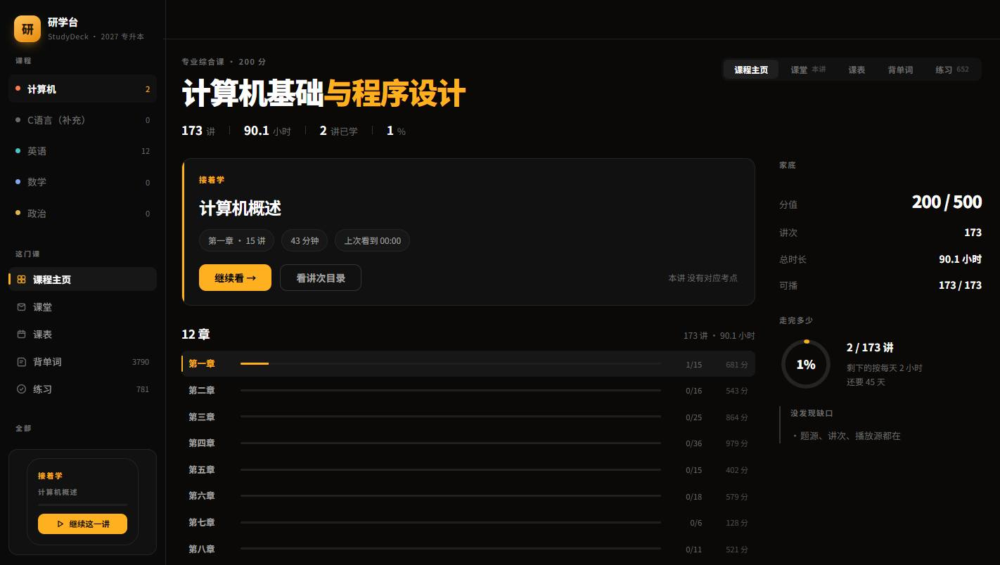
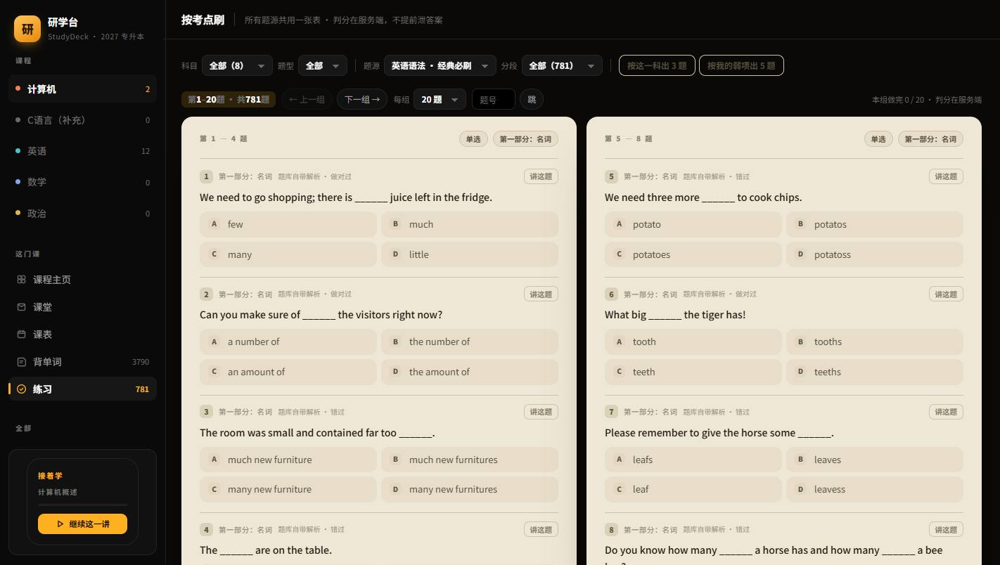

# 研学台 StudyDeck

AI Native 学习工作台。前端是界面，后端是 AI 接入层与本机数据层：Agent 通过工具注册表直接操作本机的课程、题库、笔记与计划，流式对话驱动，全程无云端依赖。

| | |
|---|---|
| 前端 | React 18 + TypeScript (strict) + Vite |
| 后端 | Python 3.11+ / FastAPI + SQLite |
| 形态 | 单机 Web 应用（127.0.0.1:8770），无账号、无云端、数据只存本机 |

<p align="center">
  
  
  
</p>

## 架构

```
┌───────────────────── 前端（React 18 + TS strict，16 页）─────────────────────┐
│ 课程主页 / 课堂 / 练习 / 考场 / 画布（自研导图引擎）/ 截图库 / 全局搜索 / 助手 │
│ 流式渲染（SSE）· 思考可视化 · 操作卡 · 设计系统 · 三档响应式                  │
└────────────────────────────────┬────────────────────────────────┘
                                 │ SSE /api/agent/stream · REST /api/tool/{name}
                                 ▼
┌───────────────── AI 接入层（FastAPI）─────────────────┐
│ agent.py      Agent 循环：多轮工具编排、操作卡、空转保护 │
│ tools.py      工具注册表（186 个，装饰器注册）           │
│ model_router  模型出口路由、上下文压缩                   │
│ evidence.py   证据检索：引文逐字命中原文才允许出现        │
│ store.py      SQLite 数据层（20 张表）                   │
└───────────────────────────────────────────────────────┘
```

要点：

- **工具注册表**：186 个本机工具以 `@tool(name, perm, desc)` 装饰器注册；写盘类工具返回必须自报成效（`say`/`effect`），未自报被强制标注 `unknown` 并显示在界面。
- **Agent 循环**：SSE 推送七类事件（token/think/step/run/substep/tool/end）；写盘权限三档（readonly/ask/auto），确认链路可恢复。
- **证据优先**：讲题先在本机题库/讲义检索，引文必须逐字命中原文，捞不到就明说「没有依据」。
- **性能**：`/api/base` gzip 后 23.4 KB + ETag/304；懒加载分包，首屏 JS 84 KB；同步工具走线程池，不堵事件循环。

## 运行

```bash
pip install fastapi uvicorn

cp server/config.example.json server/config.local.json   # 填自己的模型 Key（不填走平台出口）

cd app && npm install && npm run build                   # 产物输出 web/app-dist/

python -m server.main                                    # 或双击 start.bat
# http://127.0.0.1:8770
```

`data/` 为空也能启动：界面如实显示本机没有题源/课程，不塞假数据。

## 测试

`tests/` 下 180+ 个无头探针：起真实服务、开无头 Chrome、断言界面真实行为（判分落库、翻页可达、无 console error）。每项功能「构建 + 探针全绿」才算完成。

## 目录

```
app/        前端源码（React + TS，Vite 构建到 ../web/app-dist）
server/     FastAPI：agent / tools / model_router / evidence / store
web/        静态资源与旧版壳（/old）
tests/      无头探针（依赖本机数据，不随仓库断言真实数据）
data/       本机数据（gitignore，不入库）
```

## 许可

个人项目。第三方组件见 `web/halo/README-upstream.md`（PolyForm Noncommercial）与各包许可证。
